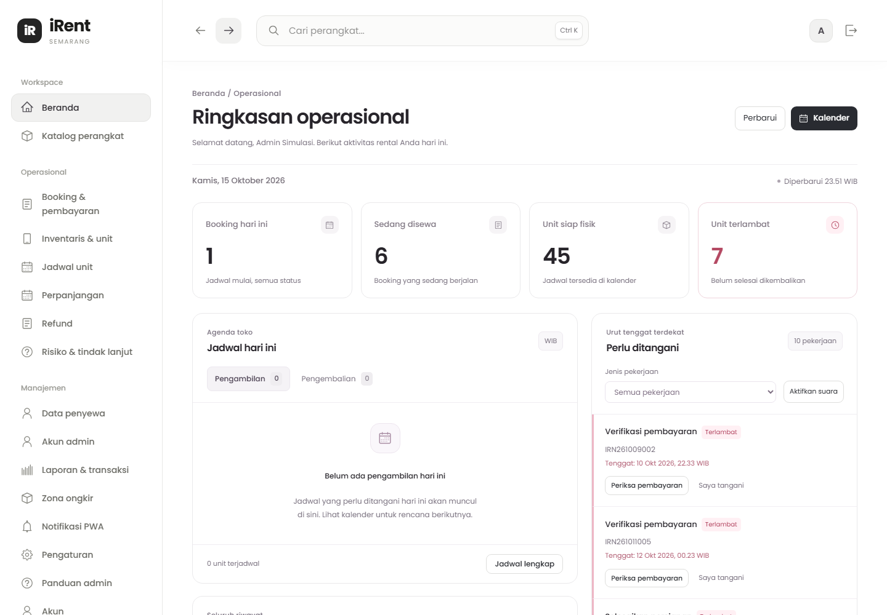
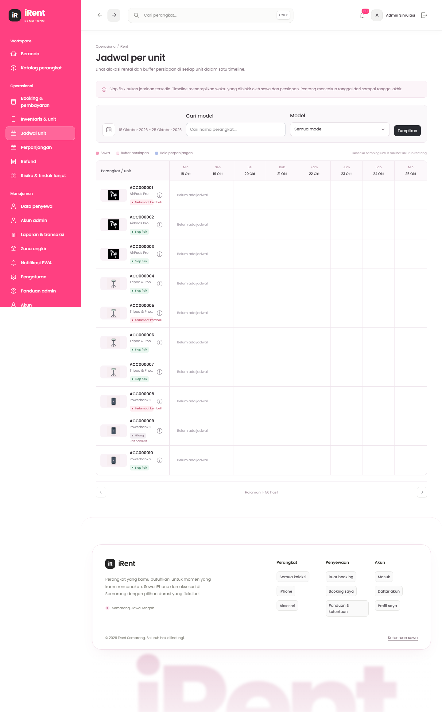
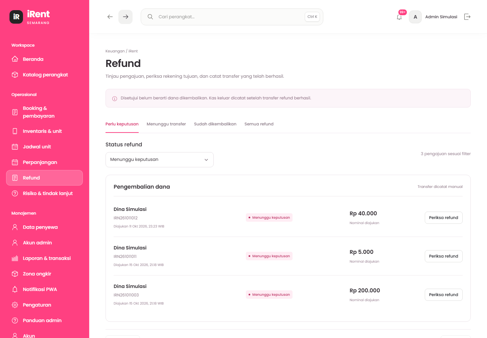

# Panduan lengkap admin iRent Semarang

Langkah penggunaan seluruh fitur administrasi, dari menyiapkan perangkat hingga menyelesaikan sewa dan transaksi.

## Untuk pemilik dan petugas operasional

Website: [https://irentsmg.tech](https://irentsmg.tech)
Area admin: [https://irentsmg.tech/admin/](https://irentsmg.tech/admin/)

Edisi 22 Oktober 2026 · Versi 1.0

> Buku ini menjelaskan fitur yang tersedia pada versi aplikasi yang diperiksa. Contoh nominal dan waktu merupakan ilustrasi. Saat bertugas, ikuti rincian, tagihan, dan batas waktu yang tampil pada booking terkait.

<!-- page -->
# Cara menggunakan buku ini

Panduan ini ditujukan kepada admin toko. Tidak diperlukan pengetahuan pemrograman. Semua waktu bisnis menggunakan **WIB** dan nominal menggunakan **rupiah bulat**.

## Cara membaca instruksi

- **Nama tebal** biasanya merujuk pada menu, tombol, judul bagian, atau informasi penting di aplikasi.
- Urutan bernomor menjelaskan tindakan yang perlu dilakukan. Setelah menyimpan, selalu periksa hasil pada halaman detail.
- Kotak berwarna merah muda berisi hal yang perlu diperhatikan sebelum melanjutkan.
- Gambar merupakan ilustrasi tampilan dengan data contoh. Posisi elemen dapat berbeda menurut ukuran layar dan pembaruan aplikasi.

## Tiga hal yang harus dibedakan

| Hal yang diperiksa | Makna untuk admin |
| --- | --- |
| Status booking | Tahap pemesanan dan pemakaian barang. |
| Saldo pembayaran | Uang yang benar-benar diterima, sudah diterapkan pada tagihan, atau perlu dikembalikan. |
| Kondisi dan kesiapan unit | Keberadaan fisik barang, hasil pemeriksaan, perawatan, serta persiapan. |

Booking **selesai** masih dapat memiliki denda yang belum dibayar. Unit yang sudah diterima belum otomatis **ready**. Bukti pembayaran yang diunggah belum berarti uang sudah masuk.

## Ruang lingkup

Buku mencakup akun, pelanggan, inventaris, tarif, zona pengiriman, pengaturan, booking, pembayaran, kalender, serah-terima, pengembalian, perpanjangan, refund, risiko, laporan, PWA, dan notifikasi. WhatsApp dan OTP belum menjadi alur operasional pada versi ini.

> Simpan buku ini untuk petugas yang berwenang. Buku tidak memuat password, kunci server, NIK pelanggan, atau akses rekening toko.

<!-- page -->
# Daftar isi · Persiapan dan sewa

{{CONTENTS_A}}

<!-- page -->
# Daftar isi · Penyelesaian dan kontrol

{{CONTENTS_B}}

<!-- page -->
# 01 · Persiapan sebelum menerima booking

Lakukan pengaturan awal sebelum mengarahkan pelanggan untuk memesan. Data model tanpa unit fisik tidak menambah stok yang bisa disewa.

## Urutan penyiapan toko

1. Masuk memakai akun admin yang diberikan pengelola. Buka **Akun** dan ganti password awal.
2. Tambahkan akun petugas melalui **Akun admin** sesuai kebutuhan. Gunakan akun masing-masing agar jejak tindakan dapat ditelusuri.
3. Buka **Pengaturan sewa**. Periksa jam layanan, batas pembayaran dan konfirmasi, DP, denda, pembatalan, serta perpanjangan.
4. Unggah **QRIS toko** yang benar jika menerima pembayaran QRIS. Pastikan nama merchant dan kode dapat dibaca.
5. Buat model melalui **Inventaris & unit**: nama, kategori, kelengkapan, tarif 6/12/24 jam, dan foto.
6. Tambahkan setiap unit fisik. Cocokkan kode iPhone dengan barang yang ada; untuk aksesori, isi jumlah unit sebenarnya.
7. Siapkan **Zona antar-jemput**, termasuk tarif dan status aktif untuk kecamatan yang dilayani.
8. Buka katalog publik. Periksa foto, nama, harga, kelengkapan, dan informasi penyewaan dari sudut pandang pelanggan.
9. Pasang PWA pada perangkat petugas, aktifkan izin notifikasi, lalu siapkan pemantauan dashboard selama jam layanan.

## Pemeriksaan terakhir

Pastikan tidak ada tarif contoh, kode unit ganda, QRIS lama, atau zona yang belum disepakati. Siapkan akses mutasi bank/QRIS dan prosedur penerimaan tunai agar petugas bisa memverifikasi uang secara nyata.

> Jangan membuat booking atau transfer fiktif pada produksi untuk mencoba aplikasi. Untuk latihan, minta pengelola menyediakan lingkungan uji terpisah.

<!-- page -->
# 02 · Masuk, navigasi, dan mencari halaman

1. Buka [irentsmg.tech/login](https://irentsmg.tech/login), isi identitas login dan password akun admin, lalu masuk.
2. Pastikan area yang terbuka adalah **Admin**. Jika tampil halaman pelanggan atau akses ditolak, periksa akun yang digunakan.
3. Gunakan menu samping untuk berpindah fitur. Pada layar kecil, buka tombol menu terlebih dahulu.
4. Klik judul, kode booking, atau tombol detail untuk membuka catatan terkait. Ikon **chevron** membuka bagian informasi yang dilipat.
5. Gunakan halaman **Panduan admin** untuk membaca ringkasan alur saat bekerja; pilih topik di sisi kiri atau pilihan topik pada ponsel.

## Peta menu

| Kebutuhan | Menu tujuan |
| --- | --- |
| Melihat tugas hari ini | Beranda |
| Memeriksa pesanan dan uang masuk | Booking & pembayaran |
| Mengatur model, foto, dan barang fisik | Inventaris & unit |
| Memeriksa benturan waktu | Jadwal per unit |
| Memproses tambahan waktu | Perpanjangan |
| Memutuskan dan mencatat pengembalian uang | Refund |
| Menangani unit bermasalah | Risiko booking |
| Mengelola penyewa dan petugas | Data penyewa; Akun admin |
| Rekap uang dan transaksi | Laporan & transaksi berhasil |
| Operasional toko | Zona antar-jemput; Pengaturan sewa; Notifikasi PWA |

> Kolom **Cari perangkat** di navigasi atas mencari katalog perangkat. Untuk mencari pesanan, gunakan pencarian di **Booking & pembayaran**, bukan kolom katalog tersebut.

<!-- page -->
# 03 · Akun sendiri dan mengganti password

Gunakan fitur ganti password saat pertama menerima akses, setelah password diketahui orang lain, atau saat ingin memperbarui keamanan akun.

## Langkah mengganti password

1. Buka **Akun** pada area admin.
2. Periksa informasi akun untuk memastikan akun yang sedang digunakan benar.
3. Buka bagian ganti password, lalu masukkan **password saat ini**.
4. Isi **password baru** sepanjang **8–128 karakter**. Password baru harus berbeda dari password saat ini.
5. Ketik ulang password baru pada kolom konfirmasi. Gunakan ikon mata jika perlu memeriksa pengetikan secara privat.
6. Kirim formulir. Jika berhasil, masuk kembali dengan password baru.
7. Aktifkan kembali notifikasi pada perangkat bertugas setelah login ulang, karena penggantian password mencabut sesi dan langganan push sebelumnya.

## Jika proses gagal

| Gejala | Tindakan |
| --- | --- |
| Password saat ini salah | Periksa huruf besar/kecil dan akun yang digunakan; sesi tidak otomatis berakhir hanya karena salah satu percobaan. |
| Konfirmasi berbeda | Samakan kedua kolom password baru. |
| Terlalu banyak percobaan | Tunggu pembatasan percobaan; jangan menekan tombol berulang-ulang. |
| Lupa password admin | Hubungi pemilik/pengelola aplikasi. Jangan mengandalkan OTP atau tautan lupa password yang belum tersedia. |

## Mengakhiri tugas

Pilih **Keluar** saat selesai, terutama pada perangkat bersama. Menutup tab bukan tindakan logout. Jangan menyimpan password pada komputer yang digunakan bergantian.

<!-- page -->
# 04 · Akun admin dan data penyewa

## Menambah akun petugas

1. Buka **Akun admin**, lalu pilih **Tambah admin**.
2. Isi nama petugas, email, dan password awal 8–128 karakter.
3. Periksa ejaan email dan identitas pemilik akun sebelum menekan **Buat akun admin** dan menyelesaikan konfirmasi yang ditampilkan.
4. Berikan akses melalui saluran pribadi. Minta petugas mengganti password awal melalui akun sendiri.
5. Pastikan akun baru muncul pada daftar. Jika jaringan terputus, periksa daftar terlebih dahulu sebelum membuat akun kembali.

Pembuatan akun admin bukan pendaftaran pelanggan. Jangan membagikan satu akun kepada semua petugas. Tindakan di akun admin memiliki kewenangan operasional, keuangan, dan akses data pribadi.

## Memeriksa penyewa

1. Buka **Data penyewa**. Gunakan pencarian dan halaman daftar untuk menemukan pelanggan.
2. Buka detail pelanggan. Periksa identitas, kontak, kelengkapan profil, dan riwayat booking yang tersedia.
3. Jika perlu memeriksa NIK, gunakan kontrol tampilkan pada detail. Cocokkan seperlunya dengan dokumen yang diperlihatkan pelanggan.
4. Buka riwayat booking dari pelanggan tersebut untuk menelusuri transaksi tanpa mencampurnya dengan akun lain.

## Mereset password pelanggan

Pilih **Ganti password pelanggan** pada detail pelanggan setelah memastikan identitas pemohon. Isi password pengganti sesuai aturan dan konfirmasikan. Reset mencabut sesi pelanggan; pelanggan perlu login ulang. Sampaikan password secara privat dan minta pelanggan menggantinya sendiri.

> NIK disembunyikan secara default dan aksesnya dicatat. Jangan mengambil tangkapan layar NIK, mengirimkannya ke grup, atau menyalinnya ke catatan pembayaran.

<!-- page -->
# 05 · Beranda dan prioritas pekerjaan

Beranda membantu memilih pekerjaan yang perlu ditangani terlebih dahulu. Informasi ringkas bukan pengganti pemeriksaan detail booking.

## Rutinitas membuka shift

1. Buka **Beranda** dan periksa tugas pembayaran yang mendekati batas konfirmasi.
2. Periksa jadwal pengambilan dan pengembalian hari ini. Cocokkan kode booking, waktu, unit, serta metode pickup/delivery.
3. Buka tugas melalui tautannya. Baca bukti, saldo, dan kondisi unit sebelum menjalankan tindakan.
4. Periksa booking berisiko, barang terlambat, dan unit yang persiapannya belum selesai.
5. Setelah tindakan berhasil, kembali ke Beranda dan pastikan tugas/ringkasan diperbarui.

## Urutan kerja yang disarankan

Tangani bukti mendekati tenggat, pelanggan yang akan mengambil barang, barang yang benar-benar telah kembali, kemudian refund dan pekerjaan administrasi lain. Jika ada risiko benturan jadwal, periksa segera tanpa menunggu pelanggan berikutnya tiba.

> Membuka tugas, membaca notifikasi, atau menekan **Saya tangani** pada pengingat suara tidak mengonfirmasi pembayaran dan tidak menyelesaikan proses bisnis. Tetap jalankan tindakan pada detail transaksi.

<!-- page -->
# 06 · Memahami status yang ditampilkan

## Status booking

| Status | Arti dan langkah admin |
| --- | --- |
| Dipesan — menunggu pembayaran | Pelanggan berhasil memesan; slot ditahan sesuai tenggat. Pelanggan dapat langsung mengunggah bukti. |
| Menunggu verifikasi pembayaran | Bukti sudah masuk dan perlu diperiksa. Cocokkan mutasi sebelum menerima pembayaran. |
| Booking dikonfirmasi | Pembayaran awal memenuhi syarat. Periksa sisa sewa/ongkir sebelum menyerahkan barang. |
| Sedang disewa | Serah-terima tercatat; pantau jadwal kembali dan permintaan perpanjangan. |
| Selesai | Semua unit telah ditutup melalui pengembalian atau kehilangan. Periksa apakah tagihan masih tersisa. |
| Kedaluwarsa / Ditolak / Dibatalkan | Proses awal tidak berlanjut. Uang yang ternyata sudah masuk tetap perlu direkonsiliasi dan diperiksa hak refund-nya. |

## Status fisik dan pemakaian unit

**Allocated** berarti unit dialokasikan pada booking. **In use** berarti sedang dipakai. **Return pending** adalah laporan pelanggan yang belum diverifikasi. **Returned** berarti pengembalian terverifikasi; **lost closed** berarti ditutup sebagai kehilangan.

Pada inventaris, **ready** berarti fisik siap; **preparing** masih dipersiapkan; **awaiting check/perawatan** perlu penanganan; **lost** berarti hilang. Kode internal dapat muncul pada rincian tertentu.

## Status pembayaran dan refund

Bukti **pending** belum diputuskan, **verified** sudah diperiksa, dan **rejected** ditolak. Dana **reserved** belum seluruhnya memenuhi kewajiban; **applied** sudah digunakan untuk memenuhi tagihan. Refund **disetujui** belum berarti uang sudah dikembalikan.

> Selalu baca status bersama nominal dan riwayat. Satu badge tidak cukup untuk menentukan boleh tidaknya menyerahkan barang atau mentransfer refund.

<!-- page -->
# 07 · Menambah dan mengubah model perangkat

**Model** adalah jenis barang pada katalog, misalnya iPhone 13. **Unit** adalah setiap barang fisik, misalnya IP13-001 dan IP13-002. Satu model dapat memiliki beberapa unit.

## Membuat model baru

1. Buka **Inventaris & unit**, lalu klik **Tambah model**.
2. Pilih kategori **iPhone** atau **aksesori** sesuai barang. Kategori tidak diubah setelah model dibuat.
3. Isi nama model yang jelas dan mudah dikenali pelanggan. Hindari nama umum seperti “Barang 1”.
4. Isi tarif **6 jam, 12 jam, dan 24 jam** dalam rupiah bulat, tanpa simbol mata uang pada kolom angka.
5. Isi daftar kelengkapan paket satu per satu, misalnya perangkat, charger, dan pouch. Daftar ini menjadi acuan saat serah-terima dan pengembalian.
6. Periksa status aktif model. Selesaikan peninjauan dan konfirmasi pembuatan.
7. Buka detail model, unggah foto, lalu tambahkan unit fisik. Periksa kembali katalog publik.

## Mengubah model

Buka detail model dan tindakan ubah **Model & tarif**. Koreksi nama, kelengkapan, harga, atau status aktif, kemudian tinjau dan simpan. Perubahan model berlaku untuk penawaran baru; rincian transaksi lama mengikuti snapshot saat pemesanan.

## Aturan tarif

Skema awal menggunakan 6/12/24 jam, lalu kelipatan 24 jam sampai batas maksimum yang diizinkan. **Tarif dan pilihan durasi tidak dibedakan antara weekday dan weekend.** Jangan membuat model duplikat khusus akhir pekan untuk mengakali harga.

> Jika respons pembuatan terputus, cari model tersebut terlebih dahulu. Pembuatan model tidak boleh diulang sembarangan karena dapat menghasilkan catatan ganda.

<!-- page -->
# 08 · Menambah unit fisik dan mengontrol stok

1. Buka **Inventaris & unit**, cari model, kemudian buka detailnya.
2. Di bagian **Unit fisik**, klik **Tambah unit**.
3. Untuk iPhone, isi **Kode unit iPhone**, satu kode per baris. Gunakan label yang benar-benar terpasang pada perangkat, misalnya `IP13-001`.
4. Untuk aksesori, isi **Jumlah unit aksesori** yang benar-benar dimiliki. Sistem membuat kode unit aksesori secara otomatis.
5. Klik **Periksa unit baru**. Cocokkan jumlah dan daftar kode dengan barang fisik.
6. Konfirmasikan, lalu periksa daftar unit dan ringkasan jumlah stok.

## Ketentuan kode dan jumlah

- Kode iPhone dinormalisasi menjadi huruf besar dan harus unik. Jangan menggunakan kode yang sama untuk dua perangkat.
- Kode aksesori memakai pola otomatis seperti `ACC000001`. Jangan memakai pola tersebut untuk iPhone.
- Menambah 3 aksesori berarti mencatat 3 barang fisik, bukan menambah jumlah hanya agar pelanggan dapat memesan lebih banyak.
- Jika koneksi putus setelah menyimpan, periksa kode/jumlah unit pada daftar sebelum mengulang.

## Mengaktifkan atau menonaktifkan unit

Buka menu tindakan pada unit, pilih **Aktifkan unit** atau **Nonaktifkan unit**, periksa ringkasan, kemudian konfirmasikan. Penonaktifan hanya diperbolehkan saat unit bebas, layak, ready, dan tidak memiliki alokasi aktif.

Unit yang sudah dialokasikan tidak boleh dihilangkan dari stok untuk menyelesaikan masalah booking. Gunakan penggantian unit atau tindak lanjut risiko. Riwayat unit dan transaksi tetap disimpan; pengurangan stok dilakukan melalui penonaktifan, bukan penghapusan riwayat.

> Jumlah unit aktif atau ready pada daftar inventaris belum membuktikan ketersediaan untuk tanggal tertentu. Periksa **Jadwal per unit**.

<!-- page -->
# 09 · Foto katalog dan perawatan unit

## Mengunggah atau mengganti foto model

1. Buka detail model, lalu pilih **Ganti foto**.
2. Pilih foto barang dalam format **JPG, PNG, atau WebP**, maksimal **5 MB** dan **16 megapiksel**. Gunakan gambar diam, bukan animasi.
3. Periksa pratinjau: barang terlihat jelas, orientasi benar, dan tidak memuat data pelanggan atau bukti transaksi.
4. Selesaikan unggahan dan konfirmasi. Buka katalog untuk memastikan cover tampil benar.

Satu model menggunakan satu foto cover pada versi ini. Jika file ditolak, ekspor ulang sebagai JPG/PNG dengan ukuran lebih kecil, lalu unggah kembali setelah memastikan kegagalan sebelumnya.

## Memulai perawatan unit bebas

1. Buka detail model dan menu unit yang akan dirawat.
2. Pilih **Mulai perawatan**. Isi alasan spesifik, misalnya “Port pengisian tidak stabil saat pemeriksaan”.
3. Periksa kode unit dan konfirmasikan. Unit bebas yang memenuhi syarat masuk alur perawatan.
4. Jika ditolak karena ada alokasi aktif, buka booking terkait. Jangan memaksa status fisik atau menghapus catatan alokasi.

## Setelah perawatan selesai

Pilih **Selesaikan perawatan** setelah fungsi barang benar-benar diperiksa. Unit masuk persiapan satu jam yang baru. Setelah waktunya terpenuhi dan barang siap, jalankan **Selesaikan persiapan/Tandai siap** sesuai tindakan yang muncul.

> Menyelesaikan perawatan tidak langsung membuat unit ready. Pengembalian yang rusak juga perlu mengikuti alur perawatan, bukan sekadar mengganti catatan kondisi pada transaksi lama.

<!-- page -->
# 10 · Zona antar-jemput

Zona menentukan wilayah delivery yang dapat dipilih pelanggan dan tarif antar-jemput yang ditawarkan.

## Menambah zona

1. Buka **Zona antar-jemput**, lalu pilih **Tambah zona**.
2. Isi **Nama kecamatan** sesuai wilayah yang benar-benar dilayani.
3. Isi **Tarif antar-jemput (rupiah)**. Tarif zona adalah biaya antar dan jemput sesuai skema toko, bukan angka per perjalanan yang otomatis dikalikan lagi.
4. Pilih **Status zona** aktif atau nonaktif. Gunakan nonaktif bila wilayah belum siap dilayani.
5. Periksa ringkasan, simpan, dan pastikan zona muncul dengan tarif serta status yang benar.

## Mengubah zona

Buka tindakan **Ubah zona** pada wilayah terkait, ubah nama/tarif/status, kemudian tinjau dan konfirmasikan. Setelah perubahan, periksa pilihan delivery pada alur pelanggan.

## Yang perlu diperiksa saat booking delivery

- Kecamatan yang dipilih dan alamat rinci pelanggan harus sesuai cakupan layanan.
- Pastikan nomor kontak, waktu pengantaran, dan rencana penjemputan dapat dijalankan petugas.
- Cocokkan ongkir di detail booking. Tarif booking lama mengikuti snapshot transaksi, sehingga tidak serta-merta berubah karena tarif zona diperbarui.
- Perpanjangan sebagian unit dapat memerlukan quotation ongkir tambahan dan persetujuan pelanggan; ikuti bab perpanjangan delivery.

> Menonaktifkan zona menghentikan pilihan baru pada zona tersebut. Booking delivery yang sudah terbentuk tetap perlu ditangani berdasarkan rincian dan kesepakatan yang tercatat.

<!-- page -->
# 11 · Pengaturan jam layanan dan jadwal

Pengaturan berpengaruh terhadap transaksi baru dan validasi operasional. Lakukan perubahan dengan pemilik toko, lalu catat sejak kapan kebijakan baru diberlakukan.

## Mengubah pengaturan

1. Buka **Pengaturan sewa**, kemudian pilih **Ubah pengaturan**.
2. Cari kelompok pengaturan yang relevan. Baca satuan pada label: menit, jam, hari, persen, atau rupiah.
3. Ubah nilai yang disepakati. Periksa kembali agar, misalnya, 2 jam tidak terisi sebagai 2 menit.
4. Jalankan peninjauan dan **Simpan pengaturan sewa**.
5. Periksa nilai tersimpan. Jika aplikasi meminta memuat ulang karena pengaturan berubah oleh admin lain, muat ulang dan kaji lagi sebelum menyimpan.

## Pengaturan jadwal

| Pengaturan | Cara menggunakannya |
| --- | --- |
| Jam buka / jam tutup WIB | Batas layanan yang dipakai dalam pemeriksaan jadwal. Default awal 08.00–22.00. |
| Jarak minimal pengambilan | Jeda minimal pemesanan ke pengambilan; default awal 120 menit. |
| Durasi maksimal | Batas total sewa; skema awal maksimal 168 jam atau 7 hari. |
| Tanggal pembukaan booking bulan depan | Mengatur kapan pemesanan bulan berikutnya dibuka; default awal tanggal 25. |
| Persiapan unit (menit) | Buffer kalender untuk pengaturan ketersediaan. Berbeda dari kewajiban persiapan fisik satu jam setelah verifikasi pengembalian. |
| Batas no-show | Ambang tindak lanjut ketidakhadiran; default awal 180 menit dengan syarat sesuai jenis pengambilan. |

> Angka di buku adalah acuan bawaan, bukan jaminan nilai toko saat ini. Booking yang sudah dibuat mempertahankan snapshot aturan yang relevan; baca tenggat dan rincian pada booking tersebut.

<!-- page -->
# 12 · Pengaturan pembayaran, refund, dan QRIS

## Kelompok kebijakan yang perlu diperiksa

| Kelompok | Isi yang diatur |
| --- | --- |
| Pembayaran & konfirmasi | DP; batas bayar reguler/mendesak; ambang booking mendesak; SLA konfirmasi; batas sebelum pickup; pengingat dan eskalasi. |
| Persiapan & denda | Buffer kalender; toleransi terlambat; tarif denda per unit per jam. |
| Pembatalan & refund | Cutoff pembatalan serta persentase pengembalian DP dan pembayaran penuh. |
| Perpanjangan | Jarak minimal pengajuan; batas bayar; waktu pemeriksaan admin; batas konfirmasi sebelum waktu kembali. |

Default awal DP **Rp20.000 per booking**, toleransi **60 menit**, denda **Rp10.000 per unit per jam yang mulai terpakai setelah toleransi**. Total booking yang tidak melebihi DP harus dibayar penuh.

Refund pembatalan pelanggan secara default: **lebih dari 48 jam** sebelum pengambilan mendapat 50% dana DP yang diterapkan atau 75% dana pembayaran penuh yang diterapkan. Tepat 48 jam atau kurang mendapat 0% dari dasar tersebut. Kelebihan dan dana tertentu yang belum diterapkan mengikuti perhitungan terpisah dari sistem.

## Mengganti QRIS toko

1. Pada **Pengaturan sewa**, cari **QRIS toko** dan pilih **Ganti gambar QRIS**.
2. Unggah JPG/PNG/WebP maksimal 5 MB dan 16 megapiksel. Pastikan kode tidak terpotong dan nama merchant benar.
3. Periksa pratinjau lalu simpan. Cek tampilan pilihan pembayaran pelanggan.
4. Jika ingin menghapus, gunakan **Hapus QRIS toko** dan baca konfirmasi sebelum melanjutkan.

> Foto QRIS bersifat publik. Bukti pembayaran dan bukti refund bersifat privat. Penggantian QRIS baru tidak boleh dijadikan alasan menghapus gambar lama yang masih dirujuk booking sebelumnya.

<!-- page -->
# 13 · Mencari dan membaca detail booking

1. Buka **Booking & pembayaran**.
2. Cari menggunakan kode booking atau nama pelanggan. Gunakan filter status untuk mempersempit pekerjaan.
3. Periksa urutan daftar dan halaman berikutnya bila transaksi belum terlihat. Tidak muncul di halaman pertama bukan berarti booking hilang.
4. Buka kode booking. Cocokkan identitas pelanggan, waktu pengambilan/pengembalian, pickup/delivery, dan unit yang dialokasikan.
5. Baca tenggat, tagihan awal, bukti yang belum diperiksa, dana yang diterapkan, dan sisa kewajiban.
6. Buka bagian yang dilipat dengan ikon chevron untuk melihat receipt, rekonsiliasi, pengembalian, perpanjangan, refund, atau riwayat.

## Bagian penting pada detail

| Bagian | Yang harus dicocokkan |
| --- | --- |
| Penyewa & pengambilan | Nama/kontak, metode pengambilan, alamat atau zona. |
| Perangkat & jadwal | Model, kode unit, durasi, jadwal awal dan jadwal efektif bila berbeda. |
| Bukti & verifikasi | Bukti pending, waktu unggah, nominal, serta tindakan pemeriksaan. |
| Receipt & rekonsiliasi | Uang aktual, referensi, koreksi, dan penerimaan terlambat. |
| Serah-terima & pengembalian | Catatan fisik dan tindakan per unit. |
| Perpanjangan / refund / riwayat | Proposal terkait, hak pengembalian dana, dan jejak perubahan. |

> Pelanggan dapat menyelesaikan pemesanan dan langsung mengunggah bukti selama tenggat masih berlaku. Tidak ada tahap persetujuan admin yang harus ditunggu sebelum pelanggan boleh mengunggah bukti pertama.

<!-- page -->
# 14 · Tenggat pembayaran dan konfirmasi

Selalu ikuti waktu yang tampil pada booking. Batas unggah bukti pelanggan dan batas pemeriksaan admin adalah dua waktu yang berbeda.

## Acuan bawaan

| Kondisi | Batas dan tindakan |
| --- | --- |
| Booking reguler | Penahanan pembayaran awal 2 jam sejak pemesanan. |
| Booking mendesak 2–3 jam sebelum pickup | Batas unggah awal 30 menit, mengikuti tenggat aktual pada detail. |
| Pemeriksaan reguler | Maksimal 24 jam sejak bukti diunggah, tetapi tidak melewati 1 jam sebelum pickup. |
| Pemeriksaan mendesak | Maksimal 1 jam sejak unggah, tetapi tidak melewati 1 jam sebelum pickup. |
| Bukti tepat waktu masih pending | Admin tetap harus memutuskan. Keterlambatan admin tidak berarti pembayaran otomatis disetujui. |

## Contoh booking mendesak

Pelanggan booking pukul **10.00** untuk pickup **13.00**. Dengan aturan bawaan, batas unggah tampil **10.30**. Bila bukti diunggah **10.20**, batas pemeriksaan menjadi **11.20**: satu jam sejak unggah masih lebih awal daripada batas terakhir pukul 12.00.

Jika pickup pukul **12.00** pada contoh lain, batas pemeriksaan dapat terpotong menjadi **11.00**, yaitu satu jam sebelum pickup. Karena itu jangan hanya menambahkan satu jam sendiri tanpa membaca batas pada layar.

## Jika sudah terlambat

Periksa status terbaru. Untuk uang yang benar-benar masuk sesudah booking terminal, gunakan rekonsiliasi; jangan menganggap unggahan lama atau transfer terlambat menghidupkan kembali booking dan alokasinya.

> Pengingat mendekati tenggat membantu prioritas kerja. Notifikasi bukan pengganti pemantauan daftar pembayaran, terutama bila perangkat sedang offline atau izin notifikasi dimatikan.

<!-- page -->
# 15 · Memverifikasi bukti pembayaran

## Pemeriksaan sebelum menerima

1. Buka booking dan bagian **Bukti & verifikasi**. Pilih bukti yang masih menunggu pemeriksaan.
2. Buka bukti secara privat. Cocokkan penerima, waktu, nominal, metode, dan informasi transaksi.
3. Buka mutasi rekening atau catatan QRIS toko melalui layanan resmi. Pastikan transaksi benar-benar telah diterima, bukan hanya berhasil ditampilkan pada gambar pelanggan.
4. Cocokkan agar transaksi bank yang sama tidak digunakan untuk dua booking.
5. Pilih **Verifikasi uang masuk** dan isi data berdasarkan transaksi nyata.

## Kolom formulir

| Kolom | Cara mengisi |
| --- | --- |
| Nominal | Jumlah aktual yang diterima, bukan otomatis jumlah yang diklaim pelanggan. |
| Waktu transaksi WIB | Saat uang benar-benar masuk; jangan menggantinya dengan waktu admin membuka bukti. |
| Metode pembayaran | Transfer, QRIS, atau tunai sesuai penerimaan sebenarnya. |
| Rekening penerima | Wajib untuk transfer/QRIS; gunakan identitas penerima yang benar. |
| Referensi transaksi | Referensi bank/QRIS yang dapat ditelusuri, bukan teks acak. |
| Catatan pemeriksaan | Jelaskan hasil cocok mutasi secara ringkas dan spesifik. |

6. Centang pernyataan pemeriksaan, buka tahap tinjau, lalu konfirmasikan.
7. Setelah berhasil, periksa receipt, dana applied/reserved, status booking, dan sisa tagihan. Jangan menyimpulkan lunas hanya dari notifikasi berhasil.

> Satu bukti terverifikasi dapat mencatat nominal yang belum cukup memenuhi kewajiban. Uang aktual tetap tersimpan; status booking mengikuti perhitungan dana yang memenuhi syarat.

<!-- page -->
# 16 · Bukti salah, kurang bayar, dan kelebihan

## Bukti tidak sah atau transaksi belum masuk

Klik **Tolak bukti** untuk membuka formulir **Tolak bukti pembayaran**. Isi alasan yang dapat ditindaklanjuti, periksa, lalu konfirmasikan. Contoh: “Mutasi rekening belum menunjukkan penerimaan; mohon periksa tujuan transfer.” Jangan menyatakan uang masuk jika belum terverifikasi.

Pelanggan hanya dapat mengunggah ulang bila status dan tenggat mengizinkan. Penolakan tidak otomatis memberi tambahan waktu. Baca status booking terbaru setelah tindakan.

## Nominal nyata lebih kecil dari kewajiban

1. Catat nominal yang benar-benar masuk melalui verifikasi.
2. Periksa apakah dana masih **reserved** atau sudah memenuhi pembayaran awal.
3. Informasikan sisa pembayaran berdasarkan angka di aplikasi.
4. Setelah tambahan diterima, periksa/rekam transaksi tambahan dengan referensi yang berbeda.
5. Tunggu kewajiban terpenuhi sebelum menganggap booking terkonfirmasi atau menyerahkan barang.

## Nominal nyata lebih besar

Catat seluruh jumlah aktual. Sistem menghitung kelebihan dan hak refund yang relevan. Buka permintaan refund, lengkapi rekening, lalu ikuti persetujuan dan transfer manual. Jangan mengurangi nominal receipt agar terlihat pas karena riwayat uang masuk akan menjadi salah.

## Bukti duplikat dan file bermasalah

- Referensi yang sudah dipakai harus diperiksa terhadap receipt lama; jangan mengubah satu karakter hanya agar lolos.
- Bukti pembayaran pelanggan memakai JPG/PNG/PDF maksimal 2 MB. Bila tidak terbaca, minta unggahan yang jelas selama alur masih mengizinkan.
- Jika bukti gagal dibuka, muat ulang detail atau periksa koneksi. Jangan menerima bukti tanpa pemeriksaan alternatif yang sah.

> Transfer ulang dan unggah ulang adalah dua tindakan berbeda. Jangan meminta pelanggan mentransfer lagi hanya karena gambar pertama belum terbaca sebelum memeriksa mutasi.

<!-- page -->
# 17 · Mencatat pelunasan dan penerimaan tunai

Pembayaran DP mengamankan tahap awal, tetapi barang belum boleh diserahkan bila sewa dan ongkir belum lunas dari dana yang diterapkan.

## Langkah pelunasan

1. Buka detail booking dan lihat sisa tagihan pada ringkasan pembayaran.
2. Periksa bukti pelunasan yang masih pending. Putuskan bukti tersebut terlebih dahulu sebelum mencatat penerimaan lain yang dapat menggandakan pembayaran.
3. Bila pembayaran diterima langsung, pilih **Catat pelunasan**.
4. Isi jumlah aktual, waktu penerimaan WIB, metode, dan catatan.
5. Untuk transfer/QRIS, isi rekening penerima dan referensi transaksi. Untuk tunai, gunakan metode tunai dan jangan mengarang referensi bank.
6. Periksa ringkasan, centang hasil pemeriksaan, lalu konfirmasikan.
7. Baca ulang saldo. Pastikan sewa dan ongkir telah terpenuhi sebelum melanjutkan **Catat serah-terima**.

## Contoh

Tagihan awal **Rp100.000**, DP terverifikasi **Rp20.000**. Sisa normal **Rp80.000**, selama tidak ada penyesuaian lain. Jika pelanggan hanya menyerahkan Rp50.000, catat Rp50.000 sesuai kenyataan; jangan menulis Rp80.000 agar tombol serah-terima tersedia.

Setelah pengembalian, denda atau kerusakan dapat menambah tagihan. Pelunasan tetap dapat dicatat pada booking selesai. Gunakan angka terbaru karena tagihan setelah pemeriksaan bisa berbeda dari angka saat pelanggan sebelumnya mengunggah bukti.

> Uang yang tercatat, dana reserved, dan dana applied berbeda. Bila tombol serah-terima tetap belum aktif, periksa kewajiban pembayaran dan syarat fisik; jangan mencatat receipt kedua untuk uang yang sama.

<!-- page -->
# 18 · Kalender dan ketersediaan unit

Kalender menampilkan alokasi waktu per barang fisik. Gunakan untuk merencanakan pengambilan, penjemputan, persiapan, dan penanganan risiko jadwal.

## Cara memeriksa jadwal

1. Buka **Jadwal per unit** dan pilih tanggal/rentang yang relevan melalui kontrol kalender. Maksimal 31 tanggal, termasuk awal dan akhir.
2. Cari nama perangkat, pilih model, lalu klik **Tampilkan**. Gunakan kelompok model berikutnya jika model belum terlihat.
3. Temukan kode unit yang dialokasikan pada booking.
4. Periksa blok booking sebelum dan sesudah jadwal, termasuk jeda/buffer yang ditampilkan.
5. Buka booking terkait dari kalender bila tersedia untuk melihat rincian dan mengambil tindakan dari halaman detail.

## Ketersediaan dan persaingan booking

Pencarian atau penawaran harga tidak menyimpan stok untuk pelanggan. Slot benar-benar dilindungi ketika pemesanan berhasil memperoleh alokasi. Jika dua pelanggan memesan unit yang sama pada jadwal bertabrakan, transaksi yang berhasil lebih dahulu memperoleh alokasi; permintaan lainnya harus memilih alternatif.

Unit fisik ready belum tentu tersedia pada jam yang dipilih. Sebaliknya, unit yang sedang dipakai saat ini dapat memiliki jadwal masa depan jika seluruh aturan terpenuhi, tetapi tetap harus ready saat diserahkan.

> Kalender bukan alat bebas untuk menyeret dan mengubah jadwal booking. Gunakan tindakan resmi yang tersedia. Bila perubahan operasional menyebabkan benturan, pilih penggantian unit atau pembatalan toko dengan refund sesuai haknya.

<!-- page -->
# 19 · Serah-terima pickup dan delivery

## Sebelum menyerahkan

Pastikan booking dikonfirmasi, sewa dan ongkir lunas dari dana applied, seluruh unit allocated, barang aktif/layak/ready, jadwal dan jam layanan sesuai, serta tidak ada benturan. Periksa identitas, kelengkapan, fungsi, dan kondisi bersama pelanggan.

## Langkah pencatatan

1. Buka detail booking, lalu **Serah-terima & pengembalian**.
2. Pilih **Catat serah-terima**. Tindakan berlaku untuk **seluruh unit booking**.
3. Isi **Waktu serah-terima (WIB)** sesuai kejadian nyata. Tidak boleh masa depan atau sebelum jadwal yang diperbolehkan.
4. Isi **Catatan kondisi**, misalnya kelengkapan dan hasil pemeriksaan fungsi.
5. Untuk delivery yang terlambat oleh toko, isi **Alasan keterlambatan toko** dengan keadaan sebenarnya.
6. Centang pernyataan pemeriksaan, tinjau kode unit/waktu/kondisi, lalu **Konfirmasi tindakan**.
7. Pastikan booking menjadi **Sedang disewa** dan waktu serah-terima tercatat.

## Dampak keterlambatan

Pickup terlambat oleh pelanggan **tidak menggeser waktu kembali**. Delivery terlambat oleh toko dapat menggeser jadwal efektif sebesar keterlambatan terverifikasi, tetapi sistem mengecek benturan, buffer, dan jam layanan lagi.

Jika pergeseran ditolak karena bertabrakan dengan booking berikutnya, jangan memaksakan waktu palsu. Cari unit pengganti model sama yang memenuhi syarat, atau lakukan pembatalan toko dengan pengembalian dana sesuai hak penuh.

> Jika tombol belum aktif, baca informasi yang muncul. Hambatan dapat berasal dari saldo, status, unit belum ready, atau tindakan lain yang belum selesai; bukan selalu gangguan aplikasi.

<!-- page -->
# 20 · Memverifikasi pengembalian per unit

Laporan “sudah mengembalikan” dari pelanggan tidak membebaskan unit. Admin tetap harus menerima dan memeriksa barang. Admin juga dapat memverifikasi penerimaan fisik tanpa menunggu laporan pelanggan.

## Langkah pemeriksaan

1. Buka detail booking, lalu **Serah-terima & pengembalian**.
2. Cocokkan kode unit dengan barang yang diterima. Periksa kelengkapan, kondisi, dan fungsi.
3. Pilih **Verifikasi pengembalian [kode unit]** pada unit yang benar.
4. Isi **Diterima toko (WIB)** berdasarkan saat barang tiba. Untuk delivery, isi **Diterima petugas** bila ada waktu penerimaan oleh kurir yang terverifikasi.
5. Isi **Catatan kondisi**, lalu pilih **Layak · lanjut persiapan** atau **Perlu perawatan**.
6. Isi biaya kerusakan, atau 0 jika tidak ada. Nominal positif wajib disertai catatan kerusakan.
7. Jika ada keterlambatan pihak toko yang sah, lengkapi interval pengecualian.
8. Periksa formulir, centang pemeriksaan fisik, lalu konfirmasikan.
9. Baca hasil denda, tagihan, status unit, serta kemungkinan pembatalan proposal perpanjangan yang masih pending.

## Pengembalian sebagian

Ulangi hanya untuk unit yang benar-benar diterima. Unit lain tetap sedang disewa. Booking menjadi selesai setelah seluruh unit returned atau lost closed; denda/biaya belum lunas tetap harus ditagih.

## Laporan pelanggan belum sesuai

Pilih **Tolak laporan [kode unit]**, tulis alasan yang jelas, tinjau, dan konfirmasikan. Penolakan tidak menutup sewa atau membuat barang ready.

> Unit layak masuk persiapan satu jam sejak verifikasi admin. Jangan menjanjikan barang dapat disewa lagi tepat pada waktu pelanggan menekan tombol pengembalian.

<!-- page -->
# 21 · Denda, petugas jemput, dan pengecualian

Denda menggunakan aturan snapshot booking dan waktu kejadian nyata. Menunda pemeriksaan administrasi tidak boleh menambah denda jika barang telah diterima lebih dahulu.

## Dasar waktu

- Untuk pickup, dasar penghentian denda adalah waktu **diterima toko**.
- Untuk delivery, jika waktu **diterima petugas** diisi secara sah, waktu itulah dasar penghentian denda; perjalanan menuju toko tidak menambah keterlambatan pelanggan.
- Waktu petugas harus sesudah serah-terima dan tidak lebih akhir daripada penerimaan toko. Semua waktu tidak boleh di masa depan.

## Contoh aturan bawaan

Jadwal kembali **18.00**, toleransi **60 menit**, denda **Rp10.000 per unit per jam setelah toleransi**, dibulatkan ke atas.

| Barang diterima | Contoh denda satu unit |
| --- | --- |
| 18.45 atau 19.00 | Rp0, masih dalam toleransi. |
| 19.01 | Rp10.000. |
| 20.00 | Rp10.000. |
| 20.01 | Rp20.000. |

Contoh di atas tanpa pengecualian. Hasil final pada aplikasi menjadi acuan bila ada snapshot atau interval berbeda.

## Mencatat pengecualian pihak toko

Buka **Pengecualian keterlambatan admin/petugas** pada formulir. Tambahkan pihak, waktu awal, waktu akhir, dan alasan. Pilihan petugas berlaku untuk delivery. Interval tumpang tindih dihitung sekali oleh sistem; jangan menambah interval duplikat agar potongan lebih besar.

> Pengecualian dipakai untuk fakta yang dapat dipertanggungjawabkan, bukan untuk menghilangkan denda tanpa alasan. Pemeriksaan perpanjangan tertentu juga dapat menghasilkan penyesuaian otomatis jika syarat pembayaran tepat waktunya terbukti.

<!-- page -->
# 22 · Kerusakan dan koreksi pengembalian

## Saat menemukan kerusakan

1. Cocokkan kondisi dengan catatan serah-terima dan hasil pemeriksaan barang.
2. Pilih kondisi **Perlu perawatan** bila barang belum layak disewakan.
3. Isi biaya kerusakan yang benar-benar disepakati dan dapat dijelaskan. Biaya ini terpisah dari denda terlambat.
4. Tulis catatan kerusakan spesifik: bagian yang rusak, hasil pengecekan, dan dasar nominal. Jangan menulis “rusak” saja.
5. Konfirmasikan pengembalian, kemudian pantau unit melalui inventaris dan tagihan melalui booking.

## Jika catatan pengembalian sudah terlanjur salah

1. Buka detail booking dan unit yang sudah terverifikasi.
2. Pilih **Koreksi pengembalian [kode unit]**.
3. Perbaiki waktu diterima toko/petugas, catatan, biaya kerusakan, atau pengecualian yang benar.
4. Isi **Alasan koreksi**. Periksa data lama dan baru sebelum konfirmasi.
5. Setelah berhasil, baca penyesuaian denda/biaya dan saldo terbaru.

## Dampak koreksi

Riwayat awal dipertahankan. Selisih tagihan dicatat sebagai penyesuaian, bukan menghapus jejak lama. Koreksi tidak memutar ulang serah-terima, tidak mengubah status booking secara bebas, dan tidak mengulang persiapan fisik.

Tagihan yang naik menjadi saldo belum lunas. Tagihan yang turun setelah sudah dibayar dapat menghasilkan refund manual atas kelebihan. Jika koreksi terhalang refund aktif, periksa permintaan tersebut terlebih dahulu; jangan mencatat transfer keluar palsu agar koreksi bisa dilanjutkan.

> Koreksi catatan kondisi bukan tindakan memperbaiki barang. Status fisik saat ini tetap ditangani melalui perawatan dan persiapan pada inventaris.

<!-- page -->
# 23 · Persiapan satu jam hingga unit ready

Unit tidak dilepas otomatis hanya karena pelanggan melapor atau waktu persiapan sudah terlewati. Admin bertanggung jawab memastikan barang benar-benar siap.

## Alur normal setelah barang layak diterima

1. Selesaikan verifikasi pengembalian pada booking dengan kondisi layak.
2. Catat waktu mulai/batas persiapan yang ditampilkan. Persiapan fisik berlangsung **satu jam sejak verifikasi admin**.
3. Selama jeda, lakukan pemeriksaan kelengkapan, pengisian daya, pembersihan, dan kesiapan fungsi sesuai SOP toko.
4. Buka **Inventaris & unit**, detail model, dan unit yang sama.
5. Setelah batas waktu terpenuhi, pilih **Selesaikan persiapan** atau **Tandai siap** pada kontrol yang tersedia.
6. Centang hasil pemeriksaan fisik dan konfirmasikan. Pastikan status menjadi ready.
7. Periksa kalender sebelum menjanjikan unit untuk booking berikutnya.

## Alur setelah perawatan

Jika unit masuk perawatan, selesaikan perawatan terlebih dahulu. Tindakan **Selesaikan perawatan** memulai persiapan satu jam yang baru. Setelah itu admin tetap harus menjalankan penyelesaian persiapan.

## Jika belum bisa dijadikan ready

Periksa apakah satu jam sudah lewat, unit sudah layak/aktif, atau masih ada pemakaian yang belum ditutup. Muat ulang daftar setelah masalah diselesaikan. Jangan menandai unit lain sebagai pengganti tanpa mencocokkan kodenya.

> Kesiapan fisik dan saldo pelanggan sebelumnya dikelola terpisah. Barang dapat dipersiapkan meskipun denda masih ditagih, tetapi ketersediaan kalender untuk sewa berikutnya tetap harus lolos pemeriksaan.

<!-- page -->
# 24 · Memeriksa pengajuan perpanjangan

Pelanggan mengajukan tambahan waktu melalui booking yang sedang berjalan. Admin memeriksa proposal dan uang masuk; tidak mengedit akhir sewa secara bebas.

## Ketentuan utama

- Tambahan durasi **6/12/24 jam** untuk unit yang dipilih; tarif mengikuti snapshot model saat pemesanan awal.
- Total durasi tidak melewati batas maksimum, secara awal 7 hari. Waktu akhir harus sesuai jam layanan.
- Pengajuan formal paling lambat **2 jam sebelum akhir sewa lama** tiap unit yang dipilih. Tepat pada batas 2 jam masih dapat memenuhi syarat.
- Satu unit hanya memiliki satu proposal aktif. Semua unit pada satu proposal diputuskan bersama.
- Proposal pending belum mengubah jadwal kembali yang telah disetujui sebelumnya.

## Langkah admin

1. Buka **Perpanjangan**. Gunakan filter **Perlu ongkir**, **Perlu verifikasi**, atau status lain sesuai pekerjaan.
2. Buka pengajuan dan cocokkan booking, unit, akhir lama, tambahan durasi, akhir baru, serta nominal.
3. Jika masih draft quotation delivery, selesaikan alur ongkir terlebih dahulu.
4. Untuk pengajuan formal, periksa tenggat bayar dan bukti yang masuk.
5. Verifikasi penerimaan nyata melalui tindakan pembayaran perpanjangan dengan nominal, waktu, metode, rekening/referensi, dan catatan yang benar.
6. Pastikan dana yang dialokasikan untuk proposal mencukupi dan bukti pending telah diputuskan.
7. Pilih **Setujui seluruh unit**, tinjau, dan konfirmasikan. Periksa jadwal efektif terbaru pada booking dan kalender.

> Jika barang dikembalikan atau dinyatakan hilang ketika proposal masih pending, seluruh proposal terkait dapat dibatalkan, termasuk hold unit lain di proposal yang sama. Jadwal awal unit lain tetap berlaku.

<!-- page -->
# 25 · Perpanjangan delivery dan ongkir tambahan

Perpanjangan sebagian unit dapat menyebabkan pengambilan terpisah. Sistem memakai quotation agar pelanggan mengetahui dan menyetujui ongkir tambahan terlebih dahulu.

## Tahap quotation

1. Buka **Perpanjangan**, filter **Perlu ongkir**, lalu detail proposal.
2. Periksa unit yang diperpanjang dan yang kembali pada waktu lama. Pastikan kebutuhan perjalanan petugas benar-benar berbeda.
3. Isi **Ongkir tambahan (rupiah)** berdasarkan keputusan toko.
4. Isi **Alasan ongkir** yang menjelaskan kebutuhan pengantaran/penjemputan tambahan. Jika tidak ada tambahan biaya, isi 0 dengan alasan yang jelas.
5. Tinjau dan pilih **Simpan quotation ongkir**.
6. Tunggu pelanggan menyetujui quotation melalui akunnya. **Ongkir Rp0 tetap memerlukan persetujuan pelanggan.**

## Setelah pelanggan setuju

Pelanggan melanjutkan pengajuan formal. Saat itu sistem memeriksa ulang jadwal dan quotation, menahan slot tambahan yang berhasil diperoleh, serta membuat kewajiban pembayaran. Draft quotation sebelumnya belum menahan stok dan belum menjadi persetujuan tambahan waktu.

Admin kemudian memeriksa bukti, menerima pembayaran nyata, dan menyetujui proposal sesuai langkah perpanjangan normal. Periksa jadwal tiap unit setelah keputusan; unit yang tidak diperpanjang tetap mengikuti akhir lamanya.

## Jika quotation perlu ditolak atau diperbarui

Gunakan tindakan yang tersedia pada status proposal dan isi alasan yang tepat. Jangan meminta pelanggan membayar angka yang berbeda dari quotation aktif. Jika slot telah dipakai booking lain saat pelanggan hendak melanjutkan, cari alternatif yang memenuhi syarat; persetujuan ongkir bukan jaminan ketersediaan.

> Hindari persetujuan lisan yang dianggap sudah mengubah jadwal. Jadwal berubah setelah pengajuan formal memenuhi syarat dan persetujuan berhasil tercatat di sistem.

<!-- page -->
# 26 · Tenggat dan masalah perpanjangan

## Tenggat bawaan proposal formal

| Tahap | Batas |
| --- | --- |
| Pengajuan | Minimal 2 jam sebelum akhir sewa lama. |
| Unggah bukti | 30 menit sejak proposal formal sesuai tenggat pada layar. |
| Pemeriksaan admin | Paling lambat 1 jam sejak unggah, tetapi tidak lewat 30 menit sebelum akhir sewa lama. |
| Beberapa unit | Tenggat paling awal dari unit terkait menjadi pembatas proposal. |

## Menangani kasus umum

1. **Uang kurang:** catat penerimaan nyata; mintakan sisa sesuai tagihan. Jangan menyetujui seluruh unit bila dana proposal belum lengkap.
2. **Bukti tidak cocok:** gunakan **Tolak bukti perpanjangan** dengan alasan. Pelanggan hanya dapat melanjutkan sesuai status dan tenggat.
3. **Jadwal bertabrakan:** baca penolakan sistem. Persetujuan tidak boleh mengambil slot pelanggan lain secara diam-diam.
4. **Pengajuan perlu ditolak:** pilih **Tolak pengajuan**, isi alasan, periksa dampak pada dana dan refund. Jadwal lama tetap menjadi acuan.
5. **Uang masuk setelah proposal berakhir:** gunakan **Rekonsiliasi uang perpanjangan**. Dana dicatat dan diperiksa untuk refund; proposal tidak hidup kembali.
6. **Dana cukup tetapi pemeriksaan admin terlambat:** periksa bukti/waktu transfer. Sistem dapat menghitung pengecualian dan penyesuaian denda bila pembayaran tepat waktu benar-benar terverifikasi; tidak setiap bukti pending otomatis membebaskan denda.

## Setelah dana perlu dikembalikan

Periksa permintaan refund yang terkait dengan proposal. Lengkapi rekening, putuskan, transfer manual, lalu catat transfer. Jangan memindahkan dana perpanjangan ke booking lain tanpa alur resmi.

> Proposal pending bukan izin tetap memakai unit melewati jadwal lama. Sampaikan akhir sewa yang saat ini masih berlaku dan keputusan terbaru kepada pelanggan.

<!-- page -->
# 27 · Pembatalan pelanggan dan pembatalan toko

Pembatalan berlaku untuk seluruh booking sebelum barang diserahterimakan. Sewa yang sudah berjalan diselesaikan melalui pengembalian atau kehilangan, bukan pembatalan awal.

## Pembatalan oleh pelanggan

Pelanggan dapat membatalkan melalui akunnya dengan alasan. Admin membuka detail untuk memeriksa status, riwayat, dan perhitungan refund. Jangan menggantinya dengan pembatalan toko hanya untuk mengubah persentase tanpa dasar operasional yang benar.

## Pembatalan oleh toko

1. Buka detail booking dan periksa bahwa barang belum diserahterimakan.
2. Tentukan alasan operasional nyata, misalnya unit tidak dapat disediakan dan pengganti tidak tersedia.
3. Pilih tindakan **Batalkan booking** pada area admin.
4. Isi alasan, baca ringkasan dan konsekuensi refund, lalu konfirmasikan.
5. Pastikan status berubah dan permintaan refund atas uang terverifikasi terbentuk bila ada haknya.
6. Lengkapi rekening pelanggan dan lanjutkan proses refund manual.

## Contoh aturan bawaan pelanggan

| Keadaan | Dasar refund |
| --- | --- |
| Lebih dari 48 jam, baru DP applied Rp20.000 | 50% DP = Rp10.000. |
| Lebih dari 48 jam, penuh applied Rp100.000 | 75% penuh = Rp75.000. |
| Tepat 48 jam atau kurang | 0% dari dasar DP/penuh tersebut. |
| Pembatalan operasional toko | Pengembalian penuh dana aktual yang memenuhi hak refund. |

Dana sebagian yang masih reserved, kelebihan, dan penerimaan rekonsiliasi diperlakukan terpisah oleh sistem. Ikuti rincian nominal, bukan menghitung persentase dari semua receipt secara sembarangan.

> Pembatalan melepas alokasi kalender, tetapi tidak memperbaiki kondisi barang atau menjadikan unit yang sedang dirawat sebagai ready.

<!-- page -->
# 28 · No-show dan kegagalan delivery

No-show adalah ketidakhadiran pelanggan setelah batas yang ditentukan pada booking terkonfirmasi yang belum diserahterimakan. Ini berbeda dari keterlambatan pengembalian.

## Pickup tidak datang

1. Pantau jadwal pickup pada Beranda dan detail booking.
2. Pastikan waktu serah-terima memang belum tercatat dan periksa komunikasi dengan pelanggan.
3. Ketika ambang no-show tercapai, periksa hasil proses sistem serta catatan pada booking; jangan langsung menyatakan DP hangus hanya karena pelanggan terlambat beberapa menit.
4. Periksa nominal yang ditahan dan refund kelebihan pada detail keuangan.

Aturan bawaan menggunakan ambang **3 jam setelah jadwal pickup**. Penahanan mengikuti batas DP dari dana applied; kelebihan ditangani melalui refund. Angka dan syarat pada snapshot booking tetap menjadi acuan.

## Delivery: petugas siap tetapi pelanggan tidak dapat menerima

1. Buka **Risiko booking** dan bagian **Delivery perlu pemeriksaan no-show**, atau detail booking terkait.
2. Pada bagian **Tindak lanjut delivery**, pilih **Catat kegagalan pelanggan** untuk membuka formulir **Catat kegagalan delivery**.
3. Isi **Petugas siap menyerahkan (WIB)** berdasarkan kejadian nyata.
4. Isi **Kegagalan pelanggan terverifikasi (WIB)** serta keterangan/bukti kejadian yang diminta formulir.
5. Tinjau, konfirmasikan, lalu periksa status dan tindak lanjut pada booking.

Delivery memerlukan verifikasi admin tersebut. Tanpa catatan yang memenuhi syarat, booking tetap memerlukan tindak lanjut dan tidak otomatis membuat DP hangus. Keterlambatan pihak toko juga memengaruhi ambang pemeriksaan.

> Jangan mencatat kegagalan pelanggan jika petugas belum benar-benar siap menyerahkan atau keterlambatan berasal dari toko. Isi waktu aktual, bukan waktu yang membuat proses lebih cepat selesai.

<!-- page -->
# 29 · Memeriksa permintaan refund

Refund muncul dari peristiwa yang menghasilkan hak pengembalian dana, misalnya pembatalan, kelebihan bayar, atau proposal perpanjangan yang berakhir. Pelanggan tidak menentukan nominal refund secara bebas.

## Memilih pekerjaan

1. Buka **Refund**.
2. Gunakan **Perlu keputusan** untuk permintaan diajukan dan **Menunggu transfer** untuk yang telah disetujui.
3. Buka permintaan dan booking asal. Periksa alasan, nominal, sumber dana, perpanjangan terkait jika ada, serta riwayat keputusan.
4. Cocokkan dengan receipt nyata dan kondisi booking. Jangan memutuskan hanya berdasarkan pesan pelanggan.

## Melengkapi rekening tujuan

Minta pelanggan memastikan bank, nomor rekening, dan nama pemilik. Pelanggan dapat melengkapi melalui akunnya; admin juga dapat memakai **Simpan rekening refund** setelah mengonfirmasi datanya bersama pelanggan.

Nomor rekening adalah teks: nol di depan harus tetap disimpan. Periksa kembali sebelum menyetujui, karena rekening tidak dapat diubah setelah keputusan sesuai alur yang berlaku.

> Nominal refund dihitung dari hak dan sumber dana yang tersimpan. Jika nilainya tidak sesuai dugaan, telusuri dasar transaksi atau koreksi yang sah; jangan mentransfer angka lain lalu mencatat angka sistem seolah sama.

<!-- page -->
# 30 · Menyetujui atau menolak refund

## Menyetujui permintaan

1. Buka permintaan berstatus **diajukan**.
2. Pastikan rekening tujuan lengkap dan sudah dikonfirmasi pelanggan.
3. Periksa nominal hak refund, sumber dana, alasan, serta apakah ada koreksi transaksi yang belum selesai.
4. Pilih **Setujui refund**.
5. Baca ringkasan, centang pemeriksaan yang diminta, lalu konfirmasikan.
6. Pastikan status menjadi **disetujui/menunggu transfer**. Masukkan ke daftar tugas transfer manual.

## Menolak permintaan

Pilih **Tolak refund**, isi alasan yang jelas, tinjau, lalu konfirmasikan. Gunakan alasan berdasarkan hasil pemeriksaan, bukan sekadar “tidak bisa”. Pastikan keputusan sudah sesuai kebijakan dan jejak transaksi.

## Arti setiap tahap

| Tahap | Makna |
| --- | --- |
| Diajukan | Ada permintaan yang perlu diperiksa. |
| Disetujui | Hak dan rekening telah diputuskan; belum ada pencatatan uang keluar. |
| Sudah dikembalikan | Transfer manual telah dicatat beserta bukti dan informasi wajib. |
| Ditolak | Permintaan diputuskan tidak dilanjutkan dengan alasan tersimpan. |

## Sebelum berpindah ke aplikasi bank

Siapkan nominal tepat, nama bank, nomor rekening, nama penerima, serta kode refund/booking untuk pencocokan. Bila beberapa admin bertugas, pastikan siapa yang melakukan transfer agar tidak dua orang mengirim uang untuk permintaan yang sama.

> Tombol **Setujui refund** tidak mengirim uang melalui bank, QRIS, atau WhatsApp. Uang benar-benar dikembalikan oleh admin di luar aplikasi, lalu hasilnya dicatat pada langkah berikutnya.

<!-- page -->
# 31 · Transfer refund dan menyimpan bukti

## Langkah pelaksanaan

1. Buka refund berstatus **disetujui** dan baca ulang rekening serta nominal.
2. Lakukan transfer dari sarana pembayaran toko. Periksa nama penerima sebelum menyelesaikan transfer.
3. Setelah berhasil, simpan bukti resmi dan referensi transaksi.
4. Kembali ke iRent, pilih **Catat transfer refund**.
5. Isi nominal **tepat sama dengan nominal disetujui**. Versi ini tidak mendukung transfer refund sebagian.
6. Isi waktu transfer aktual WIB, referensi transaksi, dan catatan.
7. Unggah bukti **JPG/PNG/PDF maksimal 2 MB** yang jelas.
8. Tinjau rekening, nominal, waktu, dan lampiran; centang pemeriksaan, lalu konfirmasikan.
9. Pastikan status menjadi **sudah dikembalikan**, uang keluar muncul pada riwayat, dan bukti dapat dibuka oleh pihak berwenang.

## Jika bank sudah berhasil tetapi pencatatan gagal

Jangan langsung mentransfer ulang. Periksa detail refund, riwayat, dan mutasi bank terlebih dahulu. Jika transfer memang belum tercatat di aplikasi, catat transfer nyata yang sama dengan bukti serta referensi aslinya. Jika sudah tercatat, tidak perlu membuat pembayaran keluar kedua.

## Jika bank gagal atau masih diproses

Jangan menandai sudah dikembalikan. Pastikan status transaksi pada layanan bank dan koordinasikan petugas sebelum mencoba lagi.

> Waktu transfer harus sah dan tidak mendahului persetujuan atau berada di masa depan. Bukti refund bersifat privat; jangan memasukkannya sebagai foto katalog atau QRIS publik.

<!-- page -->
# 32 · Koreksi receipt uang masuk

Receipt adalah catatan penerimaan uang nyata. Gunakan koreksi jika nominal, waktu, metode, atau informasi penerimaan sebelumnya salah dicatat. Fitur ini bukan cara menghapus uang yang memang pernah diterima.

## Langkah koreksi

1. Buka detail booking dan bagian **Receipt & rekonsiliasi**.
2. Cocokkan receipt yang salah dengan mutasi bank/QRIS atau catatan kas asli.
3. Pada receipt sumber yang benar, klik **Koreksi receipt** untuk membuka formulir **Koreksi receipt masuk**.
4. Isi penerimaan pengganti sesuai kenyataan, termasuk jumlah, waktu, metode, rekening/referensi bila perlu, dan catatan.
5. Isi **alasan koreksi** yang menjelaskan kesalahan dan dasar perbaikan.
6. Periksa ringkasan sebelum konfirmasi. Setelah berhasil, baca saldo dan jejak koreksi.

## Contoh

Uang nyata Rp50.000 sebelumnya dicatat Rp500.000. Koreksi tidak menghapus catatan awal: sistem menyimpan receipt asli, catatan pembalik, dan receipt pengganti Rp50.000. Saldo dihitung ulang sesuai uang yang benar.

## Dampak dan pembatasan

- Koreksi tidak otomatis membatalkan atau menghidupkan booking, mengubah jadwal, atau memutar ulang perpanjangan yang telah diputuskan.
- Saldo dapat menjadi kurang bayar atau menghasilkan kelebihan yang perlu ditangani.
- Receipt yang menopang refund aktif, disetujui, atau sudah selesai dapat diblokir dari koreksi. Baca pesan sistem dan telusuri sumber dananya.
- Jangan mencatat penerimaan palsu atau pembatalan transfer keluar palsu agar hambatan tersebut hilang.

> Untuk uang baru yang belum pernah dicatat, gunakan verifikasi, pelunasan, atau rekonsiliasi sesuai status transaksi. Jangan mengoreksi receipt lama untuk menyamarkan penerimaan tambahan.

<!-- page -->
# 33 · Rekonsiliasi uang yang terlambat diketahui

Rekonsiliasi digunakan ketika uang benar-benar masuk tetapi proses booking atau perpanjangan terkait sudah berakhir, atau penerimaannya belum tercatat melalui alur normal.

## Langkah rekonsiliasi booking

1. Temukan booking berdasarkan kode dan pelanggan. Pastikan bukan booking lain yang serupa.
2. Buka **Receipt & rekonsiliasi**. Pilih **Rekonsiliasi pembayaran awal** atau **Rekonsiliasi pelunasan** sesuai kewajiban untuk membuka formulir **Rekonsiliasi uang booking**.
3. Pilih **Bukti sumber** yang terkait, atau **Tanpa bukti unggahan** bila memang tidak ada lampiran pelanggan.
4. Isi nominal, waktu penerimaan nyata WIB, metode, rekening/referensi untuk transaksi bank, serta catatan penelusuran.
5. Periksa bahwa uang tersebut belum pernah dicatat sebagai receipt lain.
6. Tinjau dan konfirmasikan. Periksa saldo serta permintaan refund yang terbentuk.

## Rekonsiliasi perpanjangan

Buka proposal terkait dan gunakan **Rekonsiliasi uang perpanjangan/dana tambahan**. Pastikan penerimaan ditempatkan pada proposal yang benar, bukan otomatis dianggap pembayaran sewa awal.

## Contoh

Booking telah kedaluwarsa, tetapi keesokan harinya admin menemukan transfer pelanggan yang nyata. Catat melalui rekonsiliasi dengan waktu transfer sebenarnya. Dana perlu diselesaikan sesuai hak refund; booking dan slot tidak otomatis aktif kembali.

Pelanggan yang tetap ingin menyewa harus memperoleh booking baru melalui pemeriksaan ketersediaan yang berlaku. Jangan menyerahkan barang hanya karena uang booking lama kini ditemukan.

> Sebelum mencatat, cari referensi transaksi pada riwayat. Satu transfer bank tidak boleh diakui dua kali melalui verifikasi dan rekonsiliasi.

<!-- page -->
# 34 · Risiko booking dan penggantian unit

Halaman **Risiko booking** menunjukkan potensi gangguan seperti barang sebelumnya terlambat, unit dirawat/nonaktif/hilang, persiapan melewati jadwal, atau unit belum ready saat pengambilan.

## Menangani risiko

1. Buka daftar risiko dan booking yang terdampak.
2. Baca kode unit, jadwal, dan penyebabnya. Cocokkan dengan keadaan fisik serta kalender.
3. Jika ada sewa sebelumnya belum kembali, telusuri booking tersebut. Jangan menandai kembali tanpa menerima barang.
4. Periksa apakah unit pengganti model sama tersedia dan memenuhi jadwal.
5. Jika pengganti tidak mungkin, pertimbangkan pembatalan oleh toko sebelum serah-terima dengan refund sesuai hak penuh.

## Mengganti unit sebelum serah-terima

1. Pada booking terkait, pilih **Ganti unit booking**.
2. Tentukan unit booking yang diganti dan **Unit pengganti** dari model yang sama.
3. Isi alasan spesifik, tinjau kode lama/baru dan jadwal, lalu konfirmasikan.
4. Pastikan kode unit baru tercatat, kalender sesuai, dan barang pengganti siap pada waktu serah-terima.

Penggantian memeriksa kondisi, hold, dan benturan kalender lagi. Tindakan tidak mengubah harga, jadwal, atau kondisi fisik unit lama. Jika barang lama bermasalah, tangani perawatannya melalui alur yang sah setelah alokasi memungkinkan.

> Risiko bukan pembatalan otomatis dan tidak membolehkan mengambil unit pelanggan lain. Sistem menjaga alokasi booking berikutnya; admin tetap harus memilih penyelesaian operasional yang memenuhi syarat.

<!-- page -->
# 35 · Kehilangan unit dan ganti rugi

Kehilangan dipakai setelah pemeriksaan fakta menyatakan unit tidak dapat dikembalikan. Jangan menggunakan fitur kehilangan untuk menutup sewa terlambat yang masih bisa ditagih atau dijemput.

## Langkah pencatatan

1. Buka detail booking yang sedang berjalan.
2. Pada unit terkait, pilih **Catat kehilangan [kode unit]**.
3. Isi **Waktu hilang terverifikasi (WIB)**. Waktu harus berada setelah serah-terima dan tidak di masa depan.
4. Isi **Catatan kehilangan**: kejadian, hasil pemeriksaan, komunikasi dengan penyewa, dan dasar keputusan.
5. Isi **Ganti rugi kehilangan (rupiah)** sesuai kesepakatan yang sah. Nominal dapat 0 jika memang keputusan yang dipertanggungjawabkan.
6. Lengkapi pengecualian keterlambatan pihak toko hanya bila relevan dan terverifikasi.
7. Tinjau unit, waktu, nominal, dan catatan; centang hasil pemeriksaan, lalu konfirmasikan.
8. Periksa tagihan ganti rugi/denda, status unit, risiko booking berikutnya, dan refund proposal perpanjangan bila ada.

## Dampak tindakan

Unit booking menjadi **lost closed**, unit fisik menjadi **hilang/nonaktif**, dan alokasi terkait ditutup. Tidak dibuat pengembalian fisik palsu atau status ready.

Unit lain dalam booking tetap berjalan. Booking selesai setelah seluruh unit returned/lost closed, tetapi kewajiban uang dapat tetap tersisa. Pelunasan ganti rugi dicatat sebagai penerimaan nyata melalui alur pembayaran yang tersedia.

> Hilangnya satu unit dapat menimbulkan risiko pada booking berikutnya. Periksa daftar risiko segera; penyelesaian kehilangan tidak otomatis menyediakan unit pengganti bagi pelanggan berikutnya.

<!-- page -->
# 36 · Laporan harian, bulanan, dan Excel

1. Buka **Laporan & transaksi berhasil**.
2. Pilih **Jenis laporan**: Harian atau Bulanan.
3. Pilih tanggal atau bulan melalui kontrol periode. Pastikan periode sesuai WIB.
4. Baca ringkasan **Uang masuk**, **Refund ditransfer**, dan **Kas bersih**.
5. Periksa **Mutasi kas**. Buka **Catatan & jejak transaksi** untuk melihat waktu kejadian, waktu pencatatan, admin pencatat, dan koreksi receipt.
6. Buka kode booking pada mutasi jika perlu memeriksa sumber transaksi.
7. Periksa **Status booking**, **Item populer**, dan **Selesai dan lunas** sesuai tujuan evaluasi.
8. Pilih **Unduh Excel**. Buka berkas `.xlsx`, cocokkan periode, lalu simpan di lokasi yang hanya dapat diakses petugas berwenang.

## Membaca angka dengan benar

| Angka | Makna |
| --- | --- |
| Uang masuk | Penerimaan kas aktual pada periode menurut waktu transaksi. |
| Refund ditransfer | Pengeluaran refund yang sudah dicatat, bukan sekadar disetujui. |
| Kas bersih | Selisih uang masuk dan refund keluar pada periode. Bukan otomatis laba bersih. |
| Refund disetujui belum ditransfer | Kewajiban yang masih menunggu transfer saat ini, melintasi semua periode. |
| Selesai dan lunas | Kelompok transaksi yang memenuhi status penyelesaian dan pelunasan sesuai definisi laporan. |

Receipt yang dikoreksi tetap terlihat dengan jejak penggantian dan dampak efektif yang sesuai. Perbedaan waktu transaksi dan waktu pencatatan dapat menjelaskan mengapa mutasi muncul pada periode sebelumnya.

> Rekap kas tidak menghitung semua biaya usaha seperti gaji dan pembelian perangkat. Jangan memakai kas bersih aplikasi sebagai laba usaha tanpa pembukuan tambahan.

<!-- page -->
# 37 · Memasang iRent sebagai PWA

PWA membuat iRent dapat dibuka dari ikon layar utama. Instalasi tersedia untuk admin dan pelanggan; **pengiriman push operasional yang dijelaskan di buku ini ditujukan kepada admin**.

## Android atau komputer dengan browser yang mendukung

1. Buka situs resmi melalui HTTPS pada browser yang mendukung instalasi.
2. Jika ajakan pemasangan muncul, pilih tindakan pasang dan ikuti konfirmasi browser.
3. Jika tidak muncul, buka menu browser dan cari **Install app/Pasang aplikasi/Tambahkan ke layar utama**, sesuai perangkat.
4. Setelah terpasang, buka iRent dari ikon dan masuk sebagai admin.

## iPhone/iPad

1. Buka situs di Safari.
2. Tekan **Bagikan/Share**.
3. Pilih **Tambahkan ke Layar Utama/Add to Home Screen** lalu konfirmasikan.
4. Buka iRent melalui ikon layar utama sebelum mengaktifkan push pada perangkat yang mendukungnya.

## Jika ajakan tidak muncul

Aplikasi mungkin sudah terpasang, browser tidak memenuhi syarat, atau pengguna sebelumnya memilih **Nanti**. Penundaan ajakan dapat berlangsung 7 hari. Menu browser tetap menjadi jalur alternatif bila tersedia.

Instalasi PWA tidak otomatis memberi izin notifikasi. Lanjutkan pengaturan pada **Notifikasi PWA**. Pada perangkat yang dipakai bersama, login dan logout tetap harus dikelola dengan benar.

> PWA bukan jaminan seluruh pekerjaan dapat dijalankan tanpa internet. Penyimpanan pembayaran, refund, serah-terima, dan tindakan bisnis memerlukan koneksi serta respons server yang berhasil.

<!-- page -->
# 38 · Push, suara pengingat, dan kotak masuk

## Mengaktifkan push perangkat admin

1. Buka **Notifikasi PWA** dari perangkat yang digunakan bertugas.
2. Periksa dukungan browser dan status izin.
3. Klik **Aktifkan notifikasi**, lalu pilih izinkan pada permintaan browser.
4. Pastikan status menjadi **Langganan push aktif**.
5. Periksa pula izin notifikasi sistem operasi dan mode fokus/senyap. Ulangi pengaturan untuk setiap perangkat yang perlu menerima push.

Jika izin **Ditolak**, ubah izin situs melalui pengaturan browser/perangkat, lalu muat ulang. Jika layanan belum aktif atau tidak didukung, hubungi pengelola dan tetap pantau dashboard.

## Suara pengingat pada Beranda

Aktifkan suara melalui tombol yang tersedia pada Beranda setelah interaksi pengguna. Suara dashboard hanya bekerja ketika tab aktif/terlihat sesuai dukungan browser, dan dapat berulang untuk tugas mendesak. Tombol **Saya tangani** meredam pengingat lokal; tindakan bisnis tetap harus diselesaikan pada booking.

## Kotak masuk dan riwayat pengiriman

Klik ikon **lonceng** untuk melihat notifikasi dalam aplikasi. Buka entri untuk menuju sumbernya; gunakan **Tandai semua dibaca** bila sudah diperiksa. Status dibaca tidak berarti tugas selesai.

Di **Notifikasi PWA**, periksa riwayat pengiriman dan halamannya untuk menelusuri hasil kirim. Status pengiriman bukan bukti bahwa admin sudah membaca, dan kegagalan push tidak membatalkan transaksi.

> Push dapat terlambat, tidak berbunyi pada mode senyap, atau dibatasi perangkat. Fitur ini bukan alarm telepon. WhatsApp dan panggilan otomatis belum digunakan. Setelah ganti password atau login ulang, periksa kembali langganan perangkat.

<!-- page -->
# 39 · Jika tindakan gagal atau data tidak sesuai

| Situasi | Langkah yang perlu dilakukan |
| --- | --- |
| Halaman gagal dimuat | Periksa internet, muat ulang, lalu gunakan coba lagi. Catat kode booking jika perlu meminta bantuan. |
| Tombol tidak aktif | Baca status, saldo, tenggat, dan syarat unit. Tutup formulir tindakan lain yang belum selesai bila relevan. |
| Sesi habis / diminta login | Masuk ulang lalu buka kembali catatan. Periksa apakah tindakan sebelumnya sudah tersimpan. |
| Akses ditolak | Pastikan akun admin yang benar. Jangan mencoba mengubah alamat API atau mengambil data lewat akun lain. |
| Konflik karena data berubah | Muat ulang detail. Admin lain, pelanggan, atau worker mungkin sudah mengubah keadaan; putuskan ulang berdasarkan data terbaru. |
| Unit atau jadwal bentrok | Periksa kalender dan booking terkait. Pilih unit alternatif yang sah atau penanganan toko; jangan mengubah waktu kejadian. |
| Referensi transaksi sudah dipakai | Cari receipt/transfer yang memakai referensi tersebut. Pastikan bukan uang yang sudah dicatat. |
| Batas waktu lewat | Ikuti status terbaru. Uang nyata yang belum tercatat diproses melalui rekonsiliasi yang tersedia. |
| Upload ditolak | Periksa format, ukuran, isi, dan keterbacaan file. Jangan mengganti bukti privat menjadi foto publik. |
| Terlalu banyak permintaan | Tunggu sesuai pesan aplikasi. Hindari klik/unggah berulang. |

## Respons terputus setelah menekan konfirmasi

Periksa detail, saldo, riwayat, dan daftar terkait sebelum mengulangi. Untuk transfer refund, cek mutasi bank juga. Untuk pembuatan model/unit, pastikan catatan belum terbentuk karena alurnya berbeda dari tindakan transaksi yang dilindungi pengulangan.

> Saat meminta bantuan, berikan kode booking, menu/tindakan, waktu kejadian WIB, dan pesan kesalahan. Tutupi NIK, password, nomor rekening lengkap, dan bukti sensitif pada tangkapan layar.

<!-- page -->
# 40 · Contoh alur sewa dari awal sampai selesai

Contoh berikut menggunakan satu unit, pickup, sewa 12 jam, tagihan Rp100.000, dan DP Rp20.000. Waktu serta angka hanya ilustrasi; seluruh syarat kalender dan operasional tetap berlaku.

1. **Pelanggan membuat booking.** Pelanggan memilih model/jadwal, melengkapi data, dan memperoleh booking beserta tenggat. Stok ditahan setelah alokasi berhasil.
2. **Pelanggan mengunggah bukti.** Pelanggan langsung dapat mengunggah dalam rentang yang diizinkan, tanpa menunggu admin menyetujui booking.
3. **Admin memeriksa DP.** Mutasi nyata menunjukkan Rp20.000. Admin memverifikasi dengan waktu serta referensi benar; status menjadi dikonfirmasi jika kewajiban awal terpenuhi.
4. **Admin memeriksa kesiapan.** Cocokkan identitas, kode unit, jadwal, kelengkapan, kondisi, dan kalender.
5. **Pelanggan melunasi Rp80.000.** Admin memeriksa uang, mencatat pelunasan, dan memastikan total applied memenuhi Rp100.000.
6. **Serah-terima dicatat.** Pada waktu yang diperbolehkan, admin mencatat waktu aktual dan kondisi. Booking menjadi sedang disewa.
7. **Barang dikembalikan.** Pelanggan dapat melapor; admin tetap memeriksa unit fisik dan mengisi waktu diterima.
8. **Admin memverifikasi.** Jika layak dan tidak terlambat, biaya tambahan 0. Booking selesai; unit masuk persiapan.
9. **Admin menyelesaikan persiapan.** Setelah satu jam dan barang siap, jalankan tindakan siap pada inventaris.
10. **Admin mencocokkan laporan.** Periksa uang masuk, status selesai/lunas, dan tidak ada refund atau tagihan terbuka yang terlewat.

> Jika salah satu tahap gagal, jangan melompati syarat melalui catatan palsu. Gunakan alur khusus di bab kurang bayar, perpanjangan, risiko, koreksi, atau refund.

<!-- page -->
# 41 · Contoh gabungan dan keputusan lapangan

## Dua unit kembali pada waktu berbeda

Booking berisi iPhone dan aksesori. iPhone diterima lebih dahulu: verifikasi hanya kode iPhone tersebut. Aksesori tetap berjalan dan denda, bila ada, mengikuti waktu kembalinya sendiri. Booking baru selesai setelah keduanya ditutup.

Jika ada satu proposal perpanjangan pending yang mencakup kedua unit, pengembalian salah satunya dapat membatalkan seluruh proposal tersebut. Periksa refund dana tambahannya; jangan menganggap aksesori otomatis mendapat waktu tambahan.

## Admin terlambat memeriksa barang

Barang diterima toko 18.30 tetapi admin baru mencatat 20.00. Isi waktu diterima **18.30** jika faktanya terverifikasi. Persiapan satu jam tetap dihitung sejak verifikasi admin, bukan dimundurkan ke 18.30.

## Barang sebelumnya belum kembali, pelanggan berikutnya datang

Jangan memverifikasi return tanpa fisik. Buka risiko dan kalender; cari pengganti model sama yang sah. Jika tidak tersedia, lakukan penyelesaian toko dan refund hak penuh sesuai alur, bukan mengambil unit yang dialokasikan pelanggan lain.

## Uang refund sudah dikirim, internet terputus

Periksa bank dan detail refund. Catat transfer yang sudah benar-benar terjadi jika belum tersimpan. Jangan mengirim transfer kedua hanya agar layar berubah.

## Pelanggan meminta sewa 24 jam pada weekend

Pilihan 24 jam tersedia sesuai ketersediaan dan aturan yang sama dengan weekday. Tidak ada tarif atau durasi khusus weekend pada skema ini. Periksa jam mulai/akhir dan buffer sebelum menjanjikan barang.

> Keputusan operasional mengikuti peristiwa nyata, kewenangan akun, saldo, dan alokasi yang sah. Catatan alasan membantu penelusuran, tetapi tidak menggantikan pemeriksaan uang atau barang.

<!-- page -->
# 42 · Checklist shift dan serah-terima petugas

## Awal shift

- Masuk dengan akun sendiri; periksa tanggal/waktu dan koneksi.
- Buka Beranda, daftar bukti pending, tenggat konfirmasi, dan jadwal pickup/delivery.
- Periksa barang yang terlambat, daftar risiko, serta unit preparing/perawatan.
- Pastikan perangkat notifikasi aktif dan satu petugas jelas bertanggung jawab atas transaksi mendesak.

## Sebelum menyerahkan barang

- Identitas dan booking cocok; pembayaran awal disetujui.
- Sewa dan ongkir lunas dari dana yang diterapkan.
- Kode, kelengkapan, kondisi, kesiapan, dan jadwal unit sesuai.
- Waktu serta catatan serah-terima dicatat setelah kejadian nyata.

## Saat menerima barang

- Cocokkan setiap kode unit; periksa kelengkapan dan fungsi.
- Isi waktu penerimaan aktual, kondisi, kerusakan, dan pengecualian yang sah.
- Periksa denda/saldo; lanjutkan perawatan atau persiapan.
- Selesaikan kesiapan hanya setelah satu jam dan pemeriksaan fisik terpenuhi.

## Akhir shift

- Cocokkan kas, transfer, QRIS, receipt, koreksi, serta refund yang benar-benar ditransfer.
- Catat booking belum lunas, bukti pending, proposal perpanjangan, refund menunggu keputusan/transfer, dan risiko esok hari.
- Serahkan daftar pekerjaan dengan kode booking dan tindakan berikutnya; hindari menyalin NIK atau password.
- Unduh laporan bila diperlukan, simpan secara privat, lalu **Keluar** dari perangkat bersama.

> Penutupan shift bukan berarti semua booking harus dipaksa selesai. Pertahankan status yang mencerminkan fakta dan serahkan pekerjaan terbuka secara jelas.

<!-- page -->
# 43 · Istilah, batas fitur, dan bantuan

| Istilah | Arti praktis |
| --- | --- |
| Model / unit | Jenis barang pada katalog / setiap barang fisik berkode. |
| Snapshot | Salinan harga, aturan, dan rincian saat transaksi dibuat. |
| Hold / alokasi | Penahanan slot / penempatan unit pada jadwal booking. |
| Receipt | Catatan uang yang benar-benar diterima. |
| Reserved / applied | Dana yang belum sepenuhnya memenuhi kewajiban / dana yang sudah diterapkan ke tagihan. |
| Rekonsiliasi | Mencatat dan mencocokkan penerimaan nyata yang belum terselesaikan melalui alur biasa. |
| Adjustment | Penyesuaian tagihan dengan jejak, tanpa menghapus catatan asal. |
| Quotation | Penawaran biaya yang perlu disetujui sebelum proses formal tertentu. |
| Audit / riwayat | Jejak siapa melakukan tindakan, kapan, dan dengan alasan apa. |
| PWA / push | Akses aplikasi dari ikon / pesan perangkat yang memerlukan dukungan dan izin. |

## Batas versi dan eskalasi

Belum ada WhatsApp/telepon otomatis, OTP email/WA, transfer bank otomatis, atau editor bebas jadwal/status/riwayat. Instalasi PWA pelanggan tidak berarti push operasional pelanggan sudah tersedia.

Jika membutuhkan pemulihan database, perubahan akses administratif yang tidak tersedia di layar, atau penyelidikan saldo yang tidak dapat diselesaikan melalui tindakan sah, hubungi pemilik/pengelola teknis. Backup dan pemulihan server bukan tombol dalam area admin.

## Dasar penyusunan

Panduan diperiksa terhadap PRD, dokumentasi aturan backend, dan halaman admin pada repositori iRent per 22 Oktober 2026, termasuk fitur ganti password dan panduan admin terbaru. Untuk perubahan kebijakan setelah tanggal ini, gunakan nilai yang tampil dan minta panduan diperbarui.

> Saat eskalasi, sertakan kode booking/refund, langkah yang dilakukan, waktu WIB, pesan sistem, dan hasil yang diharapkan. Jangan memberikan password atau akses server melalui catatan transaksi.
